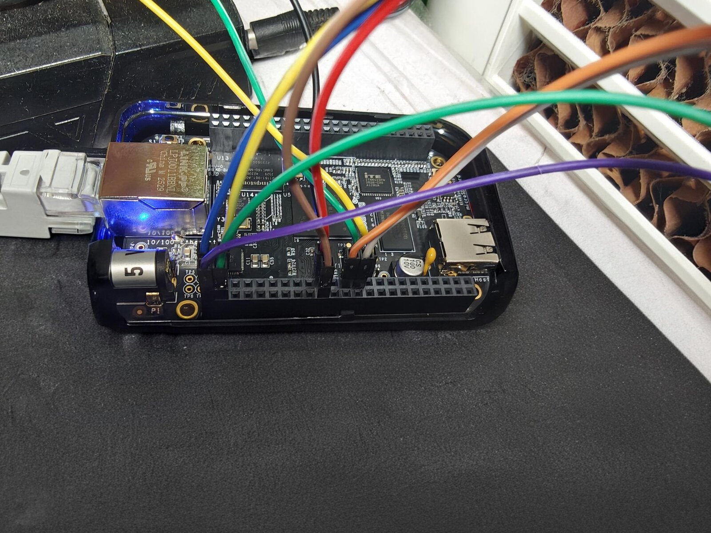
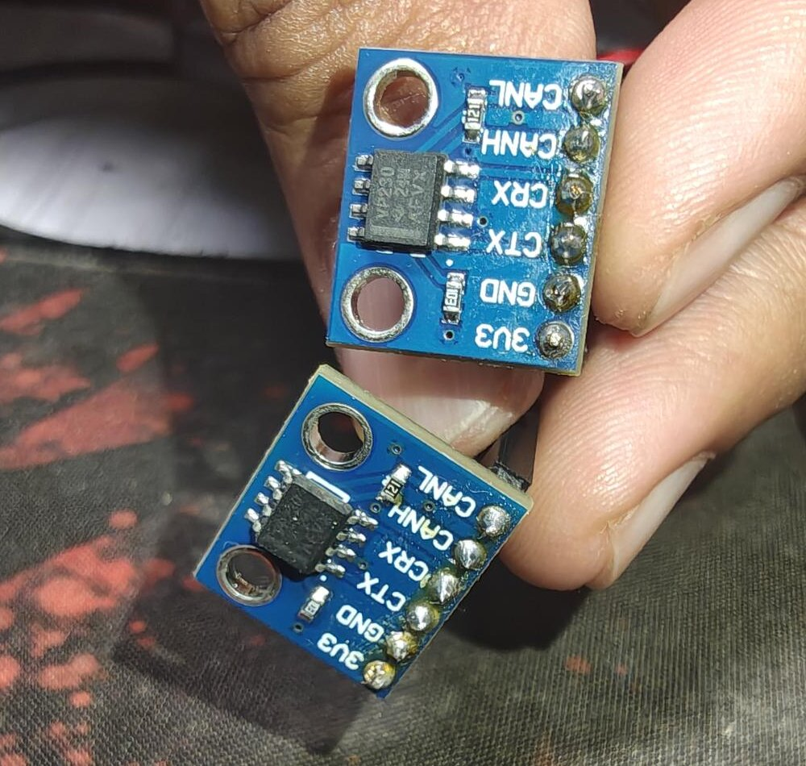

# CAN Bus Analyzer

A Linux kernel module that watches a CAN bus from inside the kernel, running on a BeagleBone Black. It hooks the board's DCAN1 controller through SocketCAN with `can_rx_register()`, so it sees every frame without opening a socket. Each frame is timestamped, counted, checked against filter rules and, if it passes, stored in a ring buffer that user space reads from `/dev/can_analyzer`. Alongside that it keeps per-ID counts, a once a second frame rate and bus load estimate, and counts CAN error frames by class.

It is a six week project to learn kernel driver work on real hardware: softirq context, kfifo, RCU, hrtimers, a character device, generic netlink, sysfs and a device tree overlay. Everything below has been run on my board, and every number in this README comes from those runs. The session by session record, including the hardware faults that had to be found first, is in [docs/DEVLOG.md](docs/DEVLOG.md). How the parts fit together is in [docs/architecture.md](docs/architecture.md).

## What it does

- Registers twice with the CAN core: once for all data frames, once for error frames (they are only delivered to receivers that ask for them).
- Stores accepted frames in a kfifo, 256 frames by default. A full buffer drops the new frame and counts it. It never overwrites an old one.
- `/dev/can_analyzer`: one text line per `read()`, blocking or non-blocking, `poll()` support, and ioctl calls for the filter rules.
- Filter rules on CAN ID and mask, accept or drop. Exact IDs live in a hash table, masked rules in a list, and the receive path reads both under RCU without taking a lock.
- `/proc/can_analyzer/stats`: totals, frames per second, peak rate, estimated bus load, per-ID counts and error classes.
- A generic netlink family `can_analyzer` to read the statistics, add and delete rules, and a multicast group that reports every error frame as it happens. `userspace/can_analyzer_tool` is the client.
- sysfs: `/sys/class/misc/can_analyzer/enable` turns capture on and off, `frame_count` shows how many frames were seen.
- `dts/can_analyzer.dts`, a device tree overlay that sets the DCAN1 pin mux and enables the controller.

## Hardware

- BeagleBone Black (TI AM3358), booted from an SD card with the BeagleBoard.org Debian 13 (Trixie) image of 2026-09-20, kernel 6.12.109-bone72
- Two CJMCU-230 boards (SN65HVD230 transceiver, 3.3 V), each with its own 120 ohm terminator
- CP2102 USB to serial adapter for the console

The AM3358 has two CAN controllers, so one board can make a real two node bus. DCAN0 (`can0`) sends test traffic and DCAN1 (`can1`) is where the analyzer listens. A CAN frame needs a second node to acknowledge it, so a controller alone on the bus just keeps resending.





The chip marked VP230 is the SN65HVD230. The resistor marked 121 next to CANL is the 120 ohm terminator, one on each board. The jumpers go straight onto the module pins.

| | DCAN1, analyzer (can1) | DCAN0, traffic (can0) |
|-|-|-|
| Controller TX to transceiver CTX | P9_26 | P9_20 |
| Controller RX from transceiver CRX | P9_24 | P9_19 |
| 3.3 V | P9_3 | P9_4 |
| GND | P9_1 | P9_2 |

CANH goes to CANH and CANL to CANL between the two transceivers. With the power off, CANH to CANL measured 60.95 ohm at one board and 60.2 at the other, the two 120 ohm terminators in parallel. Never use the 5 V pins (P9_5 to P9_8): the BeagleBone's I/O pins are 3.3 V only.

Console: CP2102 GND to J1 pin 1, TXD to J1 pin 4, RXD to J1 pin 5, 115200 8N1. The CP2102 goes in after the board is powered and comes out before the board is powered off, so its TX line never drives a pin on an unpowered board.

## Building

Build on the board, against the kernel it is running. The module's vermagic has to match `uname -r` exactly, otherwise `insmod` refuses it with "Invalid module format".

```
sudo apt install linux-headers-$(uname -r) libnl-3-dev libnl-genl-3-dev device-tree-compiler can-utils
make -C kernel
make -C userspace
```

## Device tree overlay

P9_24 and P9_26 are UART1 pins by default. `dts/can_analyzer.dts` switches them to DCAN1 (mux mode 2, with the input receiver on for the RX pin) and enables the controller. It takes the place of BeagleBoard's `BB-CAN1-00A0` overlay. Compiled, the two have the same fragments and the same pin values, only the names differ. DCAN0 still uses `BB-CAN0-00A0`.

```
dtc -@ -I dts -O dtb -o can_analyzer.dtbo dts/can_analyzer.dts
sudo cp can_analyzer.dtbo /boot/dtbs/$(uname -r)/overlays/
```

Then in `/boot/uEnv.txt` (keep a copy of the old file):

```
uboot_overlay_addr4=BB-CAN0-00A0.dtbo
uboot_overlay_addr5=can_analyzer.dtbo
```

After a reboot, check that U-Boot applied it and that the pad registers hold the right values:

```
$ ls /proc/device-tree/chosen/overlays/
AM335X-PRU-UIO-00A0.kernel    BB-CAN0-00A0.kernel          name
BB-ADC-00A0.kernel            BB-HDMI-IT66122-00A0.kernel
BB-BONE-eMMC1-01-00A0.kernel  can_analyzer
$ sudo sh -c "grep -E '44e1098[04]' /sys/kernel/debug/pinctrl/*pinmux*/pins"
pin 96 (PIN96) 14:gpio-96-127 44e10980 00000012 pinctrl-single
pin 97 (PIN97) 15:gpio-96-127 44e10984 00000032 pinctrl-single
```

0x12 on P9_26 is mode 2 with the pull-up. 0x32 on P9_24 also turns on the input receiver. Without it DCAN1 would never hear the bus. The register values only prove the mux. The real test is a frame from `can0` arriving on `can1` with no errors, which needs both pins: P9_24 to receive the frame and P9_26 to send the ACK.

## Running

```
sudo modprobe can
./scripts/setup_can.sh
sudo insmod kernel/can_analyzer.ko ifname=can1
```

`can.ko` has to be loaded first because the module uses `can_rx_register()` from it. It normally loads the first time a program opens a CAN socket, not when the interfaces come up, so without the `modprobe` the `insmod` fails with "Unknown symbol can_rx_register (err -2)". `setup_can.sh` brings `can0` and `can1` up together at 500000 bit/s.

| Parameter | Default | Meaning |
|-|-|-|
| `ifname` | `can1` | CAN interface to listen on |
| `fifo_size` | `256` | frames the buffer holds, rounded up to a power of 2 |
| `bitrate` | `500000` | only used for the bus load estimate |

Loading prints `can_analyzer: listening on can1, buffer holds 256 frames, /dev/can_analyzer ready`. Unloading prints a summary like `can_analyzer: stopped: 3 seen, 0 filtered, 0 unread, 0 dropped`, followed by any frames nobody read.

## Using it

### Reading frames

```
$ cansend can0 123#DEADBEEF
$ cansend can0 12345678#AABB
$ cansend can0 456#01
$ timeout 1 cat /dev/can_analyzer
t=494924108804 id=0x123 len=4 data=de ad be ef
t=494953072854 id=0x12345678 len=2 data=aa bb
t=494970039317 id=0x456 len=1 data=01
```

`t` is `ktime_get_ns()`, the monotonic clock in nanoseconds, taken when the callback runs. It is not the clock dmesg uses, so the two can't be subtracted from each other. Extended IDs print with 8 hex digits. Each `read()` returns one line and needs a buffer of at least 96 bytes. With the buffer empty, `read()` sleeps until a frame arrives, or returns `EAGAIN` with `O_NONBLOCK`, and `poll()` reports `POLLIN` once a frame is waiting. With several readers, each frame goes to exactly one of them.

### Statistics

Output from the run above:

```
$ cat /proc/can_analyzer/stats
frames             3
filtered           0
dropped            0
unread             0
rate_fps           0
peak_fps           3
bus_load_pct       0.0
peak_bus_load_pct  0.0
bitrate            500000
errors             0
  tx_timeout       0
  lost_arbitration 0
  controller       0
  protocol         0
  transceiver      0
  no_ack           0
  bus_off          0
  bus_error        0
  restarted        0
  counters         0
last_ctrl_status   0x00
ids                3
  123              1
  12345678         1
  456              1
untracked          0
```

`frames` counts every data frame before filtering. `rate_fps` and `bus_load_pct` cover the last full second, the peaks are the highest seen since loading. The load counts 47 bits for a standard frame and 67 for an extended one, plus 8 per data byte, including the 3 bit gap after the frame. Stuff bits are not counted, so the estimate is a lower bound. Here the three frames add up to 217 bits, 0.04% of one second at 500000 bit/s, which shows as 0.0. The per-ID table holds 256 IDs, anything past that is added to `untracked`.

`can_analyzer_tool --stats` reads the same numbers over netlink and printed the same values as `/proc` in the same run.

### Turning capture off and on

```
$ cat /sys/class/misc/can_analyzer/enable
1
$ echo 0 | sudo tee /sys/class/misc/can_analyzer/enable
0
```

With `enable` at 0 the receive callback returns straight away, so nothing is counted, filtered or stored. On my board 3 frames gave `frame_count` 3, three more with `enable` at 0 left it at 3, and three more after `echo 1` made it 6. Writing needs root (`Permission denied` otherwise), and anything `kstrtobool()` doesn't accept is refused: `echo banana` gave `Invalid argument` and `enable` stayed 1.

### Filter rules

A rule matches when `(frame_id & mask) == (rule_id & mask)`. Exact rules are checked first, then masked rules in the order they were added, and the first match wins. With no matching rule a frame is accepted. Up to 64 rules. IDs and masks are hex, and an ID written with 8 digits is an extended (29 bit) ID, the same as `cansend`. The extended flag is always part of the comparison, so a standard rule never matches an extended frame.

Through ioctl:

```
$ sudo python3 scripts/can_rules.py add 123 7ff drop
$ sudo python3 scripts/can_rules.py add 100 700 drop
$ sudo python3 scripts/can_rules.py add 155 7ff accept
$ python3 scripts/can_rules.py list
123 mask=7ff drop
155 mask=7ff accept
100 mask=700 drop
3 rule(s)
```

With these rules, frames 150, 155, 156 and 250 sent from `can0` came out as 155 and 250. 150 and 156 fell under 100/700. 155 is inside 100/700 too, but its exact rule is checked first. The same 100/700 rule left the extended frame 00000150 alone.

Through netlink:

```
$ sudo userspace/can_analyzer_tool --add-filter 123 7ff drop
$ sudo userspace/can_analyzer_tool --del-filter 123 7ff
$ userspace/can_analyzer_tool --stats
$ userspace/can_analyzer_tool --watch-errors
```

Both paths end in the same code, so a rule added over netlink shows up in the ioctl list. Changing rules needs `CAP_NET_ADMIN` on both: a normal user gets "Operation not permitted". Listing is open to everyone. A duplicate rule is refused with `EEXIST`, which the ioctl path prints as "File exists" and the tool as "Object exists".

### Error frames

The CAN core only hands error frames to receivers that have `CAN_ERR_FLAG` in their mask, so the module registers a second receiver with the mask `CAN_ERR_FLAG | CAN_ERR_MASK`. Each class bit in the error frame's ID is counted, and for controller errors the status byte (`data[1]`) is kept as `last_ctrl_status`.

To test it, `can0` was taken down and `can1` sent a frame that nobody could acknowledge. `can1` went ERROR-PASSIVE with its transmit error counter at 128. `/proc` counted 2 error frames, in the `controller` and `counters` classes, with `last_ctrl_status` 0x20 (TX error passive). After both interfaces were up again the status went to 0x40 (back to error active). In another run, `--watch-errors` printed three events, 0x08, 0x20 and 0x08 (TX warning, TX passive, warning again), and `/proc` counted the same 3 errors.

## Measured on my board

Throughput. With a reader draining the device into `/dev/null`, `cangen can0 -g 0 -p 100 -n 20000 -I 100 -L 8` sent 20000 back to back frames with ID 0x100 and 8 data bytes. All 20000 were counted, with a peak of 4312 frames/s, an estimated peak load of 95.7%, 0 dropped and 0 errors. Derived: such a frame is at least 111 bits including the gap, so 500000 bit/s fits at most about 4504 of them per second even with no stuff bits, and 4312 is close to that ceiling.

Latency. `userspace/can_latency 1000` sends one frame every 10 ms on `can0` and times it with `CLOCK_MONOTONIC`, the same clock as `t=`: from just before `write()` to the callback's `t=`, and from `t=` to just after `read()` returns in user space. Each run had 1000 frames, all matched, none lost. Derived: with stuff bits these test frames are 118 to 123 bits, 236 to 246 us on the wire.

| Run | send to callback | callback to reader | send to reader |
|-|-|-|-|
| default, median | 413.3 us | 211.1 us | 626.6 us |
| default, repeat, median | 412.7 us | 189.6 us | 625.9 us |
| mpu_gate off, median | 270.3 us | 47.7 us | 317.7 us |
| mpu_gate off, p99 | 346.3 us | 102.5 us | 454.0 us |
| mpu_gate off, max | 388.8 us | 180.8 us | 561.0 us |

The CPU governor was `performance` at 1 GHz in every run, so frequency scaling is not the cause. Most of the default latency is the CPU waking from its deep idle state, `mpu_gate`, which has a 130 us exit latency and had been used 884998 times since boot against 19220 for WFI. Turning it off through `/sys/devices/system/cpu/cpu0/cpuidle/state1/disable` halved the median end to end latency. The drop in send to callback fits that exit latency. Why callback to reader also dropped, from about 200 us to 48 us, is not explained yet. With the default settings the worst frame took 5.6 ms end to end.

Sender limit. `cangen -i` ignores `ENOBUFS` instead of waiting, and only 1179 of 20000 frames got out. The other 18821 failed at the sender because the transmit queue (`qlen 10`) was full. The analyzer counted all 1179 that reached the bus.

Full buffer. With `fifo_size=3` the kfifo was rounded up to 4. Six frames with no reader gave 6 seen, 4 stored and 2 dropped, and the stored frames were 0x201 to 0x204, the first four. A full buffer drops the new frame.

Blocking and poll. `cat` on the device slept until frames came. `poll()` on an empty buffer with a 2 s timeout returned no events after 2.0 s. With a frame sent during a 30 s `poll()`, it returned `POLLIN` after 15.47 s. `rmmod` is refused with "Module can_analyzer is in use" while the device is open.

Bit timing, from `ip -details link show`: 500000 bit/s, sample point 0.875, time quantum 125 ns (brp 3 on the 24 MHz clock), `BTR=1c02`. Derived: 1 + 6 + 7 + 2 = 16 quanta of 125 ns is 2 us per bit.

## Limits

- The bus load is a lower bound, because stuff bits are not counted.
- Every frame is read as a classic `struct can_frame`, up to 8 data bytes.
- One interface, looked up by name when the module loads, in the initial network namespace.
- `t` is when the callback ran, not a hardware timestamp.
- The c_can driver reports bus errors (ACK, CRC, stuff, form, bit) as error frames only when the interface is brought up with `berr-reporting on`, which `setup_can.sh` does not do. State changes (warning, passive, bus-off) arrive either way.
- The per-ID table stops growing at 256 IDs.

## Repository layout

```
kernel/
  can_analyzer_rx.c        module init and exit, receive callbacks, kfifo
  can_analyzer_chrdev.c    /dev/can_analyzer, ioctl, sysfs attributes
  can_analyzer_filter.c    filter rules
  can_analyzer_stats.c     counters, hrtimer, /proc/can_analyzer/stats
  can_analyzer_netlink.c   generic netlink family
  can_analyzer.h           what the files share
  can_analyzer_uapi.h      ioctl and netlink definitions for user space
  hello/                   first test module, used to prove the build on the board
userspace/
  can_analyzer_tool.c      netlink client
  can_latency.c            times frames from send to user space
scripts/
  setup_can.sh             brings can0 and can1 up together
  can_rules.py             ioctl client for the filter rules
  setup_vcan.sh            virtual CAN interface for testing without hardware
dts/
  can_analyzer.dts         DCAN1 pin mux overlay
docs/
  DEVLOG.md                session by session record
  architecture.md          data path, locking, load and unload order
  wiring.jpg               jumper wires on the P9 header
  transceivers.jpg         the two transceiver boards
```

## License

GPL-2.0, see [LICENSE](LICENSE). `can_analyzer_uapi.h` carries the Linux syscall note so user space programs can include it.
